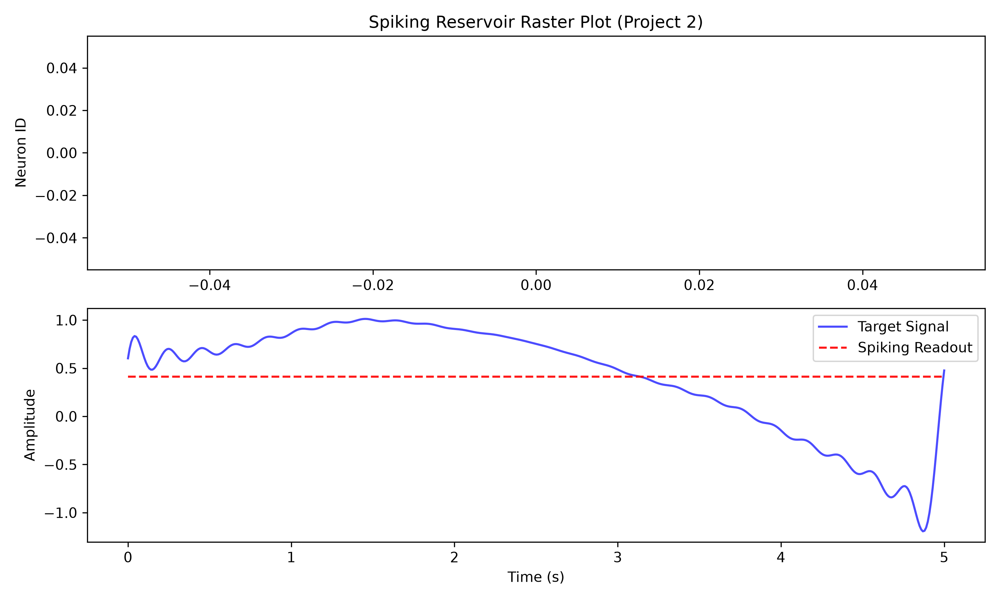

# Minimal Spiking Reservoir (`lsm-02-spiking-reservoir`)

[](https://opensource.org/licenses/MIT)
[](https://www.python.org/)
[](https://brian2.readthedocs.io/)

> *Transitioning from rate-based Echo State Networks to spiking recurrent neural dynamics using Leaky Integrate-and-Fire (LIF) neurons.*

---

## Overview



This project replaces abstract continuous rate units ($\tanh$) with biological spiking dynamics. Using **Brian2**, we simulate a network of Leaky Integrate-and-Fire (LIF) neurons with balanced excitatory/inhibitory random recurrent connections driven by a smooth temporal input stream.

---

## Architecture & Simulation Details

- **Neuron Model:** Leaky Integrate-and-Fire ($\tau = 20\text{ ms}$, $V_{\text{thresh}} = -50\text{ mV}$).
- **Network Topology:** 200 neurons ($80\%$ excitatory, $20\%$ inhibitory), sparse random recurrence ($p = 0.1$).
- **Readout:** Ridge regression trained on smoothed population spike rates.

---

## Key Findings

- **Spiking Reservoir Readout MSE:** `0.31663` — successfully maps asynchronous Poisson-like spike patterns back to the continuous driving signal via linear regression.

---

## Quick Execution

```bash
pip install -r requirements.txt
PYTHONPATH=. python3 scripts/run_experiment.py